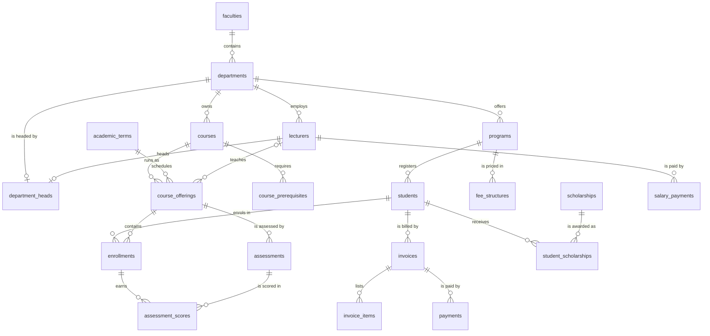

# SQL Databases Learning and Practice

## 1. About the Project

This repository provides structured learning materials and runnable SQL scripts for understanding relational databases, writing queries, changing data safely, and improving database performance.

It is designed for students, beginners, and database practitioners at the **Université Libre de Kigali (ULK)** and beyond who want to build their SQL skills through hands-on examples and graded exercises.

Every lesson works on the same sample database: a small **university management system** with academic structure, students, lecturers, courses, grades, and finance.

---

## 2. Learning Objectives

By completing the modules in this repository, learners will be able to:

- Create databases, users, and tables, and inspect them through the system catalog.
- Enforce data integrity with primary keys, foreign keys, `NOT NULL`, `UNIQUE`, `CHECK`, and `DEFAULT`.
- Insert, read, update, and delete data (`INSERT`, `SELECT`, `UPDATE`, `DELETE`, `TRUNCATE`) safely.
- Filter, sort, and paginate results, and handle `NULL` and three-valued logic correctly.
- Use string, numeric, date, `NULL`-handling functions, and `CASE` expressions.
- Summarize data with `GROUP BY`, `HAVING`, `ROLLUP`, `CUBE`, and `GROUPING SETS`.
- Combine tables with `INNER`, `LEFT`, `RIGHT`, `FULL OUTER`, `CROSS`, and self joins.
- Write subqueries, correlated subqueries, Common Table Expressions (CTEs), and recursive CTEs.
- Build views, updatable views with `WITH CHECK OPTION`, and materialized views.
- Create single, composite, unique, partial, and expression indexes, and read `EXPLAIN` plans.
- Use the three families of **window functions**: ranking, aggregate, and value access ([details](sql/11-window-functions/README.md)).
- Control changes with ACID transactions: `BEGIN`, `COMMIT`, `ROLLBACK`, `SAVEPOINT`, and isolation levels.
- Apply set operations, `EXISTS` / `NOT EXISTS`, and query optimization techniques.
- Recognize the main differences between PostgreSQL, MySQL, and Oracle.
- Connect to the database from tools and from **Python** (psycopg, SQLAlchemy, pandas), using parameterized queries, transactions, and safe credential handling.

---

## 3. The Sample Database: `ulk_university_db`

The database has **21 tables** in five areas, plus **3 views** for values that are calculated rather than stored.



*(The diagram renders on GitHub. In other viewers, use the table below.)*

| Area | Tables | What they hold |
|---|---|---|
| **A. Academic structure** | `faculties`, `departments`, `programs`, `academic_terms` | Faculties, their departments and buildings, degree programmes, and semesters |
| **B. People** | `lecturers`, `department_heads`, `students` | Lecturers with rank and salary, who heads each department, students with status and programme |
| **C. Teaching** | `courses`, `course_prerequisites`, `course_offerings`, `enrollments` | The course catalogue, which course requires which, courses running in a term with a lecturer and room, and student registrations |
| **D. Grades** | `grade_scale`, `assessments`, `assessment_scores` | Percentage → letter grade rules, CATs / assignments / exams with their weights, and each student's marks |
| **E. Finance** | `fee_structures`, `invoices`, `invoice_items`, `payments`, `scholarships`, `student_scholarships`, `salary_payments` | Fees per programme and term, student bills and payments, scholarships, and monthly payroll |
| **Views** | `final_grades`, `student_gpa`, `student_balances` | Final percentage and letter grade per course, credit-weighted GPA, and fees still owed |

### Design rules used everywhere

- Table names are plural `snake_case`; every primary key is `<singular>_id` and **auto-generated** (`GENERATED ALWAYS AS IDENTITY`). Never type a primary key value in an `INSERT`.
- A foreign key has the same name as the key it points to (e.g. `lecturer_id`).
- Money is `DECIMAL(12,2)` in Rwandan francs (RWF), never `FLOAT`.
- Values that can be calculated (final grades, GPA, balances) are **not stored**: they live in views.

### What is in the sample data

The data is small enough to check by hand: 15 students, 8 lecturers, 9 courses, 10 course offerings, 25 enrollments, 20 invoices, and 21 payments. It deliberately includes the situations the lessons need:

- **Three terms**: a past term (`term_id` 2), the current term (`term_id` 1), and the next term (`term_id` 3, registration only). IDs are *not* in date order, so always sort terms by `start_date`.
- **NULL values**: students and lecturers without a phone, a student without a date of birth, a department without a building, an offering without a lecturer or room, cash payments without a reference number.
- **Unmatched rows** for outer joins and `NOT EXISTS`: a faculty with no departments, a programme with no students, a course never offered, lecturers with no classes, a student with no enrollments, and a scholarship nobody has received.
- **Ties, failures, and debts**: students sharing the same GPA, failed courses, part-paid and unpaid invoices, and a registration that breaks a prerequisite rule.

---

## 4. Quick Start: Set Up the Database

The scripts are written for **PostgreSQL 12 or newer** and tested with **pgAdmin 4** and `psql` on PostgreSQL 15.

### Step 1: Create the database (once)

Open a Query Tool on the default `postgres` database and run [`sql/01-database-setup/01_create_database.sql`](sql/01-database-setup/01_create_database.sql), or from a terminal:

```bash
psql -U postgres -c "CREATE DATABASE ulk_university_db ENCODING 'UTF8';"
```

### Step 2: Load the tables, views, and sample data

**pgAdmin:** right-click `ulk_university_db` → **Query Tool** → open [`sql/00_master_schema_and_data.sql`](sql/00_master_schema_and_data.sql) → press **F5**.

**Terminal:**

```bash
psql -U postgres -d ulk_university_db -f sql/00_master_schema_and_data.sql
```

### Step 3: Check that it worked

```sql
SELECT registration_no, student_name, gpa
FROM student_gpa
ORDER BY gpa DESC;      -- 12 rows, three students tied on 4.00
```

> **Made a mess of the data?** Run the master script again. It drops and recreates everything, so you always get back the original sample data.

**MySQL and Oracle users:** the master script uses PostgreSQL syntax. Every lesson shows the MySQL and Oracle equivalents in its comments wherever the syntax differs, and module 15 covers each database's own features.

---

## 5. Repository Structure

The curriculum has 16 modules in the [`sql/`](sql/) folder:

| Folder | Topics | Files |
|---|---|---|
| [`01-database-setup`](sql/01-database-setup) | Creating the database, users and permissions, inspecting the catalog | `01_create_database.sql`<br>`02_create_user_and_permissions.sql`<br>`03_schema_overview.sql` |
| [`02-tables-and-constraints`](sql/02-tables-and-constraints) | Data types, primary and foreign keys, constraints, `ALTER TABLE` | `00_drop_tables_if_needed.sql`<br>`01_create_tables.sql`<br>`02_primary_foreign_keys.sql`<br>`03_check_unique_constraints.sql`<br>`04_alter_tables.sql` |
| [`03-data-manipulation`](sql/03-data-manipulation) | `INSERT`, `SELECT`, `UPDATE`, `DELETE`, `TRUNCATE` | `01_insert_records.sql`<br>`02_select_basics.sql`<br>`03_update_records.sql`<br>`04_delete_records.sql`<br>`05_truncate_tables.sql` |
| [`04-filtering-and-sorting`](sql/04-filtering-and-sorting) | `WHERE`, `AND`/`OR`/`NOT`, `BETWEEN`, `IN`, `LIKE`, `NULL`, `ORDER BY`, pagination | `01_where_and_or_not.sql`<br>`02_comparison_and_between.sql`<br>`03_in_and_like_pattern_matching.sql`<br>`04_null_handling.sql`<br>`05_order_by_and_pagination.sql` |
| [`05-sql-functions`](sql/05-sql-functions) | String, numeric, date, and `NULL` functions; `CASE` | `01_string_functions.sql`<br>`02_numeric_functions.sql`<br>`03_date_time_functions.sql`<br>`04_null_functions.sql`<br>`05_conditional_case_expressions.sql` |
| [`06-aggregate-functions`](sql/06-aggregate-functions) | `COUNT`, `SUM`, `AVG`, `MIN`, `MAX`, `GROUP BY`, `HAVING`, `ROLLUP` | `01_basic_aggregates.sql`<br>`02_group_by.sql`<br>`03_having_clause.sql`<br>`04_grouping_sets_rollup.sql` |
| [`07-joins`](sql/07-joins) | `INNER`, `LEFT`, `RIGHT`, `FULL OUTER`, `CROSS`, and self joins | `01_inner_join.sql`<br>`02_left_join.sql`<br>`03_right_and_full_outer_join.sql`<br>`04_cross_join.sql`<br>`05_self_join.sql` |
| [`08-subqueries-and-ctes`](sql/08-subqueries-and-ctes) | Subqueries, correlated subqueries, CTEs, recursive CTEs | `01_scalar_and_in_subqueries.sql`<br>`02_correlated_subqueries.sql`<br>`03_common_table_expressions.sql`<br>`04_recursive_ctes.sql` |
| [`09-views`](sql/09-views) | Views, updatable views, materialized views | `01_creating_views.sql`<br>`02_modifying_and_updating_views.sql`<br>`03_materialized_views.sql` |
| [`10-indexing-and-performance`](sql/10-indexing-and-performance) | B-tree, composite, unique, partial, and expression indexes; `EXPLAIN` | `01_single_and_composite_indexes.sql`<br>`02_unique_and_partial_indexes.sql`<br>`03_explain_and_query_plans.sql` |
| [`11-window-functions`](sql/11-window-functions) | Ranking, aggregate, and value-access window functions | `01_ranking_functions.sql`<br>`02_aggregate_window_functions.sql`<br>`03_value_access_functions.sql`<br>`README.md` |
| [`12-transactions`](sql/12-transactions) | ACID, isolation levels, `COMMIT`, `ROLLBACK`, `SAVEPOINT` | `01_acid_principles.sql`<br>`02_commit_and_rollback.sql`<br>`03_savepoints.sql` |
| [`13-advanced-sql`](sql/13-advanced-sql) | Set operations, `EXISTS` / `NOT EXISTS`, query optimization | `01_set_operations.sql`<br>`02_exists_and_not_exists.sql`<br>`03_query_optimization_techniques.sql` |
| [`14-practice-exercises`](sql/14-practice-exercises) | Graded challenges with solutions | `01_beginner_exercises.sql`<br>`02_intermediate_exercises.sql`<br>`03_advanced_exercises.sql` |
| [`15-database-specific`](sql/15-database-specific) | PostgreSQL, MySQL, and Oracle features | `postgresql/01_postgres_features.sql`<br>`mysql/01_mysql_features.sql`<br>`oracle/01_oracle_features.sql` |
| [`16-database-connections`](sql/16-database-connections) | Connection settings and strings; connecting from Python with psycopg, SQL injection, transactions, pandas reports | `README.md`<br>`01_connection_info.sql`<br>`python/01_connect_and_query.py`<br>`python/02_parameterized_queries.py`<br>`python/03_transactions_and_errors.py`<br>`python/04_reports_with_pandas.py` |

The master script [`sql/00_master_schema_and_data.sql`](sql/00_master_schema_and_data.sql) builds the whole database in one run. Modules 02 and 03 build the *same* database step by step, for students who want to see each part being created.

---

## 6. Recommended Learning Sequence

```
01-database-setup
       │
       ▼
02-tables-and-constraints
       │
       ▼
03-data-manipulation  ──▶  04-filtering-and-sorting  ──▶  05-sql-functions
                                                                 │
                                                                 ▼
08-subqueries-and-ctes  ◀──  07-joins  ◀──  06-aggregate-functions
       │
       ▼
09-views  ──▶  10-indexing-and-performance  ──▶  11-window-functions
                                                         │
                                                         ▼
15-database-specific  ◀──  14-practice-exercises  ◀──  13-advanced-sql  ◀──  12-transactions
       │
       ▼
16-database-connections  (Python)
```

---

## 7. How to Work Through a Lesson

1. Load the database once (Section 4).
2. Open a lesson file in pgAdmin's Query Tool, connected to `ulk_university_db`.
3. Read the **Concept Overview** at the top.
4. Run the queries one at a time (select a query, press **F5**) and compare your result with the expected result written in the comment beside it, e.g. `-- 3 rows: Ange, Joseph, Esther`.
5. Statements that are **meant to fail** are commented out, with the expected error below them. Uncomment one, run it, and read the error message.
6. Solve the **Practice Exercises** at the end of the file, then try the larger challenges in [`sql/14-practice-exercises/`](sql/14-practice-exercises).

### Your data stays safe

Lessons that change data (`UPDATE`, `DELETE`, `ALTER TABLE`, …) run their examples inside a transaction that is undone at the end:

```sql
BEGIN;
    UPDATE students SET status = 'Graduated';   -- try the change
    SELECT status, COUNT(*) FROM students GROUP BY status;   -- look at the result
ROLLBACK;                                       -- undo it
```

So the sample data is the same for every lesson, and your results match the comments. Views and indexes created only for a demonstration are dropped again at the end of their lesson. Module 12 explains how transactions work.

---

## 8. SQL Script Standard

Every lesson file follows the same layout:

```sql
/*
================================================================================
Topic: Comparison Operators and BETWEEN Range Filtering
Objective: Filter numbers, text and dates with comparison operators ...
Database: PostgreSQL (pgAdmin)
          MySQL / Oracle: <differences, if any>
================================================================================
*/

-- =============================================================================
-- 1. Concept Overview
-- =============================================================================
-- Short explanation of the idea, with the syntax.

-- =============================================================================
-- 2. ... (one numbered section per idea)
-- =============================================================================
-- Courses worth more than 3 credits
SELECT course_code, course_title, credits
FROM courses
WHERE credits > 3;                                      -- 4 rows: the CS courses

-- =============================================================================
-- N. Practice Exercises
-- =============================================================================
-- Exercise 1: ...
```

Every lesson file must:

- run from top to bottom without errors on a freshly loaded database, both one query at a time and as a whole file (pgAdmin **F5**);
- leave the sample data exactly as it found it;
- give the results stated in its comments.

---

## 9. Important Notes & Best Practices

- Test the `WHERE` clause of an `UPDATE` or `DELETE` with a `SELECT` first, and practise inside `BEGIN; … ROLLBACK;`.
- pgAdmin commits every statement automatically unless you start with `BEGIN`. If a transaction is left open, finish it with `COMMIT` or `ROLLBACK`.
- Remember three-valued logic: `= NULL` never matches (use `IS NULL`), and `NOT IN` returns nothing if its list contains a `NULL`.
- Check the plan with `EXPLAIN` before running heavy queries on large tables.
- [`02_create_user_and_permissions.sql`](sql/01-database-setup/02_create_user_and_permissions.sql) uses the demonstration password `admin`. Change it on any server other than your own laptop, and never commit real passwords or connection strings to version control.

---

## 10. Contributions

Students and lecturers are welcome to add examples, exercises, explanations, and corrections. Please keep the folder layout and the script standard (Section 8), and run your file on a freshly loaded database before submitting it.

---

## 11. License

This project is distributed under the [MIT License](LICENSE).
